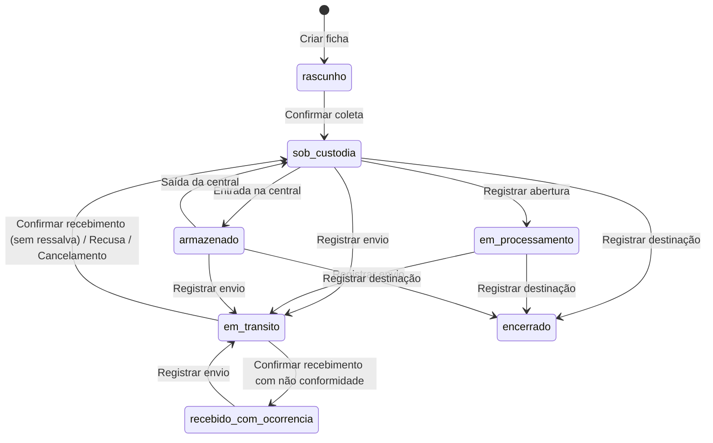

# Fluxo de custódia, estados e permissões

## Estados

- **Estado da ficha** (`fav.status`): `rascunho` → `sob_custodia` ⇄ `em_transito` → `recebido_com_ocorrencia` · `em_processamento` · `armazenado` → `encerrado`.
- **Estado físico declarado** (`fav.physical_state`): `lacrado`, `aberto`, `sem_lacre_grande_porte`, `consumido_total`.
- **Situação da transferência** (`movement.status`): `em_transito`, `recebido`, `recebido_com_ressalva`, `recusado`, `cancelado`.
- **Custodiante**: `custodian_kind` (servidor | externo), `custodian_identity_id` / `custodian_intervener_id`, `custodian_unit_id`.
  Durante o trânsito a ficha mostra "EM TRÂNSITO para X desde …" e a última confirmação (envio).

## Comandos

Todos: sessão válida, CSRF, identidade ativa, **vínculo elegível** (`requireFiller`) e, para atos de custódia,
**diretório revalidado na janela** (`DIRECTORY_STALENESS_HOURS`). Comandos de confirmação exigem `Idempotency-Key`.
Tudo em uma transação: projeção (`fav`, `movement`…), `custody_event`, `field_revision`, `idempotency_record`.

| Comando | Pré-condições | Ator permitido (unidade selecionada) | Efeitos | Exceções |
|---|---|---|---|---|
| Criar ficha | — | ORIGEM_COLETA ou REGISTRO_UNIDADE | `rascunho`, unidade de origem = contexto | — |
| Preencher/complementar | Unidade = origem ou custodiante; seção conforme papel | Coleta/Vestígio: ORIGEM_COLETA, REGISTRO_UNIDADE · Perícia: PERICIA na custodiante · Guarda: ENCERRAMENTO/REGISTRO | Revisões; versão +1 | Valor já registrado fora do rascunho = **retificação com motivo**; após encerramento só guarda documental |
| Registrar pessoa externa | Não encerrada | Qualquer papel de preenchimento na origem/custódia | `intervener` | — |
| Confirmar coleta | `rascunho`, unidade de origem, campos obrigatórios | ORIGEM_COLETA/REGISTRO; se coletor é servidor, **somente o próprio coletor** | Nº documental; `sob_custodia`; custodiante = coletor (servidor ou externo) | Colisão de nº → 409 (P-NUM-01/02) |
| Registrar envio | Estado movível, não aberto, sem transferência ativa, unidade = custodiante | Servidor da sessão (CUSTODIA, ORIGEM, REGISTRO, PERICIA). Custodiante externo: REGISTRO/ORIGEM registra documentalmente | `movement em_transito`; `fav em_transito` | 1º envio: entregador = coletor (item 11) |
| Confirmar recebimento | Movimentação `em_transito`; unidade = destino | CUSTODIA ou PERICIA; ≠ remetente | Conferência; custódia → recebedor; `sob_custodia` ou `recebido_com_ocorrencia` | Divergência física exige não conformidade |
| Recusar recebimento | idem | idem | `recusado`; custódia permanece com remetente | — |
| Cancelar envio | `em_transito` | Quem registrou o envio | `cancelado` | — |
| Retificar movimentação | — | Quem registrou o envio ou o recebimento | Revisão `retificacao` | Novo ato físico ≠ retificação |
| Registrar abertura (+ novo lacre) | Custódia, lacre vigente, fora de trânsito | PERICIA; CUSTODIA com referência de autorização | Lacre rompido; `aberto`; `em_processamento` | — |
| Registrar novo lacre | Abertura pendente | PERICIA ou CUSTODIA | Novo lacre ativo (ordinal+1); `lacrado` | Lacre rompido deve ser acondicionado; nº não reutilizável |
| Armazenamento | Custódia; não em trânsito | CUSTODIA | `storage_event`; entrada → `armazenado`, saída → `sob_custodia` | Entrada exige protocolo/local; depósito alternativo exige documento |
| Vincular FAV de amostra | Custódia; FAV não derivada | PERICIA | Nova FAV (ou existente) com vínculo recíproco | Sem vínculo próprio/circular |
| Consumo parcial | Custódia | PERICIA | Evento; custódia mantida | — |
| Registrar destinação | Custódia; não aberto (exceto análise destrutiva) | ENCERRAMENTO | `closure`; `encerrado`; guarda = unidade | Laudo obrigatório na análise destrutiva; autorização judicial na destruição/devolução |
| Etiquetas | Grande porte; requisição + procedimento; volumes | ORIGEM, REGISTRO, CUSTODIA | Lote versionado, PDF com hash | Reimpressão exige motivo |

## Papéis

| Papel | Uso |
|---|---|
| ORIGEM_COLETA | Abrir ficha, dados da coleta, confirmar coleta (coletor) |
| REGISTRO_UNIDADE | Registro na unidade (dados do vestígio, SCO), registro documental de externos |
| CUSTODIA | Envio, recebimento, armazenamento, abertura autorizada |
| PERICIA | Campos periciais, abertura/relacre, amostragem, consumo parcial |
| ENCERRAMENTO | Destinação/encerramento |
| AUDITOR | Leitura no escopo das unidades atribuídas |
| ADMIN_CONFIG | Atribuição auditada de papéis e sincronização — **sem** poder de custódia ou de leitura de fichas |

**Escopo de leitura:** a FAV é visível na unidade selecionada se ela é origem, custodiante, unidade de PJ, guarda,
origem/destino de movimentação ou local de armazenamento (`fav.fav_in_unit`). Fora disso: 404 + auditoria.
